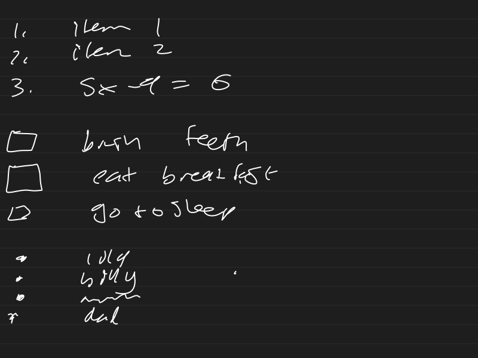

![[_handwriting/HTMD_20260831114803_CJSI.svg]]

![[_handwriting/HTMD_20260831114810_921D.svg]]

≠ &
The quick brown fox
jumped over the lazy dog.
What time are you going
to the trafford centre
and how are you getting
there and how will you
be getting back Lila you
need to be way quicker Lila you
need to be way

![[_handwriting/HTMD_20260831113234_EVA7.svg]]

$\sum_{k=0}^{5} {}_{5}C_{k} \times 4x^k \times 3^{5-k}$

$\int_{0}^{99} (5x + 3) \, dx$

1 2 3 4 5 6 7 8 9 10
a lovely little sentence

$\dfrac{\left(\dfrac{57x}{48x+9}\right)+3}{47}$

1 2 3 4 5 6 7 8 9 0
- ( : , ( ) £ & @ "
- , ; ! '
- [ ] { } # % ^ * + =
1. item 1
2. item 2
3. 5x - 9 = 6

- [ ] brush teeth
- [ ] eat breakfast
- [ ] go to sleep

* lola
* billy
* mom
* dad

- \ ? ~ ≈ < > € $ ¥
- ; ☺

1 2 3 4 5 6 7 8 9 0 , ,
- / : / ) , £ & @ "
. , ; !
- [ ] { } # % ^ * + =
- ~ ≈ < > € $ ¥
- ; ☺ ? .
